# 🩺 Prescripto — AI-Powered Dynamic Appointment Scheduler & Healthcare Management System

[](https://reactjs.org/)
[](https://vitejs.dev/)
[](https://nodejs.org/)
[](https://expressjs.com/)
[](https://www.mongodb.com/)
[](https://www.python.org/)
[](https://flask.palletsprojects.com/)
[](https://scikit-learn.org/)
[](https://www.docker.com/)
[](https://tailwindcss.com/)
[](https://razorpay.com/)

---

## 📌 Executive Summary

**Prescripto** is an enterprise-grade, full-stack healthcare web platform and AI-driven clinical triage system. It bridges the gap between symptom onset and specialized consultation by deploying predictive machine learning algorithms to diagnose conditions, triage urgency, and connect patients to the appropriate medical specialist within seconds.

The platform provides a unified ecosystem with dedicated interfaces for **Patients**, **Physicians**, and **Hospital Administrators**, backed by a microservice-oriented architecture featuring real-time dynamic appointment scheduling, Cloudinary-powered digital asset management, Razorpay digital payment processing, and production-ready Docker containerization.

---

## 🚀 Key Highlights & Engineering Capabilities

* **🤖 Intelligent Clinical Triage & Differential Diagnosis**: An integrated machine learning microservice that ingests patient-reported symptoms (over 130+ clinical vectors) to predict probable diseases, compute confidence levels, display top-3 differential diagnoses, and recommend the exact medical specialty.
* **🚨 Emergency Slot Routing Protocol**: Built-in critical care detection logic that flags life-threatening symptom configurations and immediately re-routes patients to dedicated emergency medical slots for prompt intervention.
* **📅 Conflict-Free Dynamic Slot Scheduler**: Algorithms calculating doctor availability, eliminating double-booking, and organizing consultations into dynamic 30-minute intervals across a 7-day rolling schedule.
* **💳 Secure Financial Integration**: Razorpay payment gateway integration supporting digital transactions with cryptographic HMAC-SHA256 server-side signature validation.
* **🔐 Tri-Tier Role-Based Access Control (RBAC)**: Segregated authentication pipelines utilizing JSON Web Tokens (JWT) and Bcrypt salted password hashing for Patients, Doctors, and Administrators.
* **☁️ Cloud Digital Asset Management**: Asynchronous multi-part form handling with Multer and secure Cloudinary pipeline for encrypted storage and optimized delivery of doctor credentials and user avatars.
* **🐳 Cloud-Ready Container Architecture**: Multi-stage Docker builds orchestrating Node.js, Vite React single-page applications, and an Nginx reverse-proxy gateway.

---

## 🏗️ System Architecture

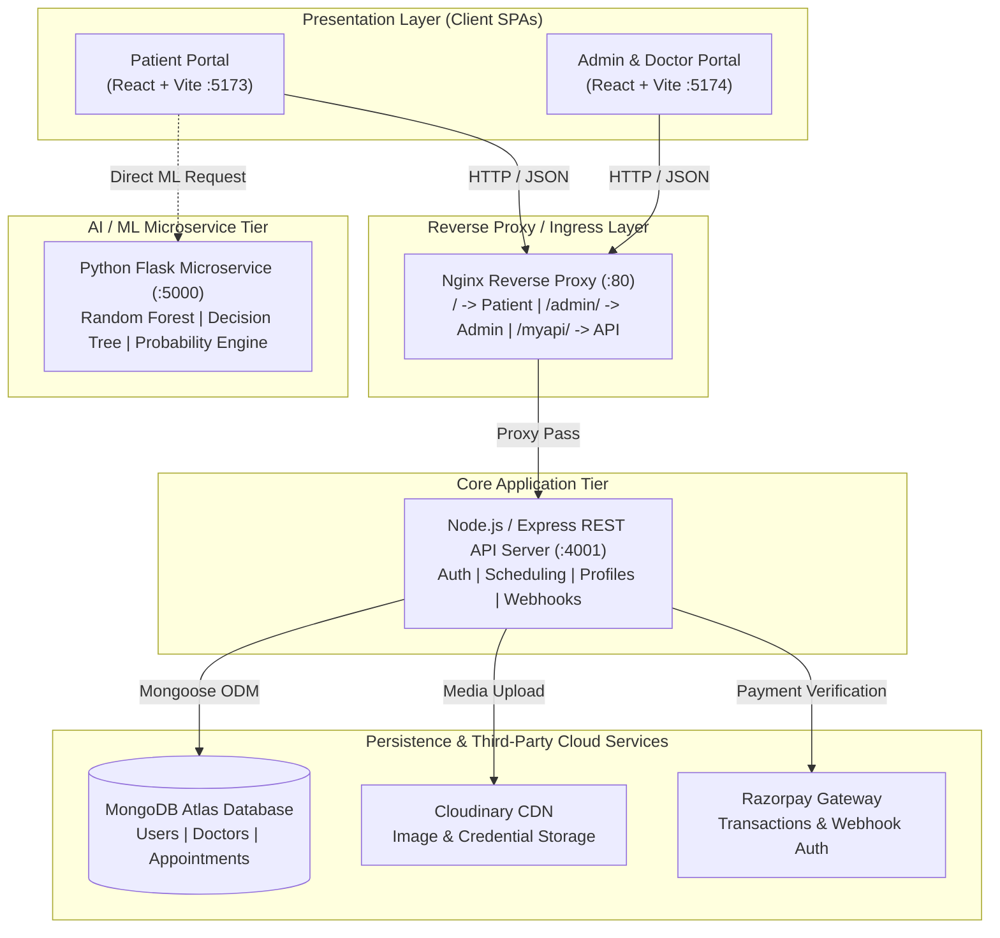

---

## 💻 Tech Stack Deep Dive

| Layer | Technologies | Justification & Use Case |
| :--- | :--- | :--- |
| **Frontend (Patient)** | React 18, Vite 6, Tailwind CSS, React Router v7, React Toastify, Axios | Ultra-fast HMR, responsive UI, component modularity, instant notification feedback. |
| **Frontend (Admin/Doctor)** | React 18, Vite 6, Tailwind CSS v4, Lucide/React Icons | Unified administrative console with role-switching logic and responsive dashboards. |
| **Backend API** | Node.js (ESM), Express.js 4.21, Mongoose 8, JWT, Bcrypt | Asynchronous I/O, RESTful endpoints, robust middleware chaining, and schema validation. |
| **Machine Learning** | Python 3.10+, Flask, Scikit-Learn, Pandas, NumPy, Pickle | High-throughput probability scoring, vector encoding, and specialist recommendation. |
| **Database** | MongoDB Atlas (Cloud NoSQL) | Highly available, scalable document store for semi-structured clinical and appointment records. |
| **Cloud & Media** | Cloudinary API, Multer (Memory Storage) | Automated CDN caching, asset transformations, and secure doctor image uploads. |
| **Payment Gateway** | Razorpay SDK (Order API & Signature Verifier) | Seamless checkout experience with tamper-proof HMAC verification. |
| **DevOps / Deployment** | Docker, Docker Compose, Nginx (Alpine) | Immutable multi-stage builds, reverse-proxy caching, and container orchestration. |

---

## 🧠 Machine Learning Engine Architecture

The clinical triage pipeline runs as an independent microservice (`ML Modelss/app.py`), ensuring complete decoupling between operational API traffic and ML computation workloads.

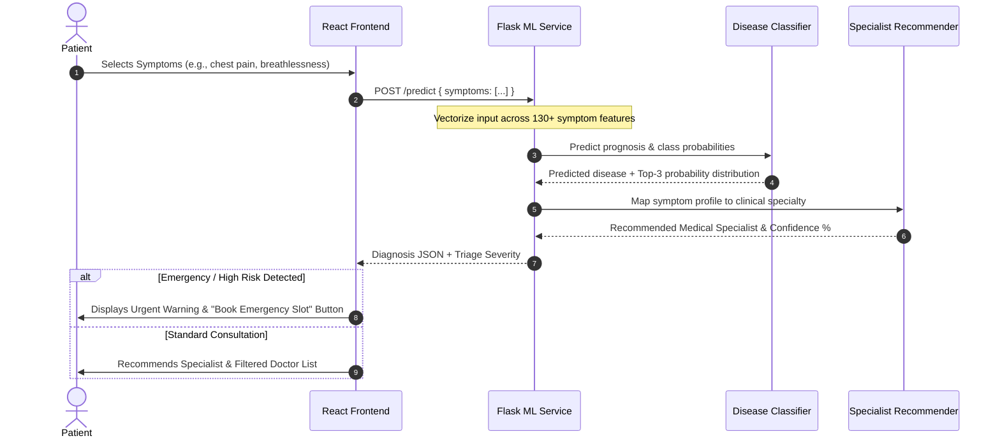

### Model Specifications
* **Dataset Vectors:** 130+ discrete binary symptom features mapped to clinical outcomes.
* **Primary Disease Classifier (`disease_prediction_model.pkl`):** Multi-class predictive model outputting the primary prognosis along with top-3 probabilistic alternatives.
* **Specialist Classifier (`model.pkl`):** Categorical recommendation engine aligning patient symptoms with medical domains:
  * *General Physician*, *Cardiologist*, *Dermatologist*, *Gynecologist*, *Pediatrician*, *Neurologist*, *Gastroenterologist*.
* **Encoders (`prognosis_encoder.pkl`, `label_encoder.pkl`):** Normalized label decoding ensuring robust serialization.

---

## 🌟 Core Application Modules

### 1. 🏥 Patient Portal
* **Intuitive Discovery:** Filter doctors by clinical specialty, experience, and consultation fee.
* **Dynamic Booking Calendar:** Interactive slot-picker providing rolling 7-day bookings with real-time disabled states for booked/unavailable slots.
* **AI Symptom Analysis:** Multi-select interactive symptom search with immediate diagnostic confidence and specialist redirection.
* **Patient Dashboard:** Track historical visits, cancel upcoming consultations, and complete pending payments via Razorpay.
* **Profile Management:** Manage medical profiles, personal information, addresses, and avatar uploads.

### 2. 👨‍⚕️ Physician Portal
* **Doctor Dashboard:** Real-time earnings tracker, patient count, and upcoming appointment summaries.
* **Consultation Management:** Ability to review clinical bookings, mark appointments as **Completed**, or issue cancellations.
* **Availability Toggle:** Instant on/off duty status toggle that propagates across the booking engine.
* **Profile Customization:** Modify consultation fees, clinic location details, and practice information.

### 3. 🛡️ Hospital Administrator Panel
* **Executive Metrics Dashboard:** Overview of total appointments, revenue trends, registered doctors, and patient volume.
* **Doctor Onboarding:** Comprehensive registration module with doctor credential capture, bio, specialty tagging, and automated Cloudinary photo processing.
* **Universal Appointment Oversight:** Master audit log of all system appointments with administrative cancellation privileges.
* **Doctor Management:** Centralized directory with global availability overrides.

---

## 🗄️ Database Architecture & Schemas

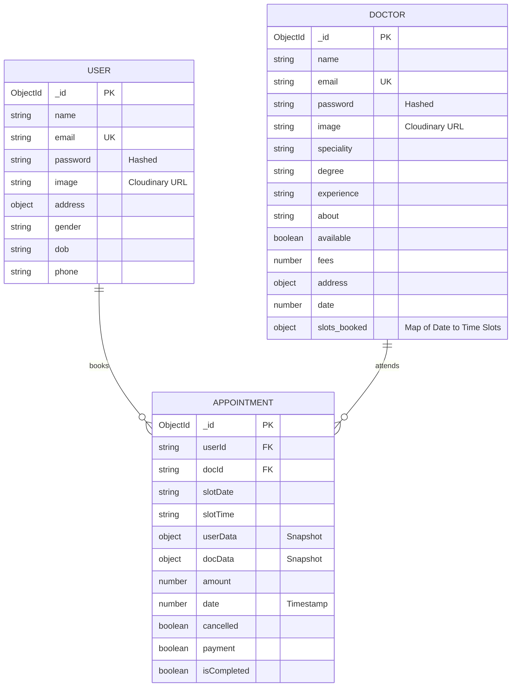

---

## 📸 Screenshots Showcase

A visual walkthrough of the platform's multi-role interfaces:

| Patient Landing & Discovery | AI Symptom Checker & Triage |
|:---:|:---:|
| 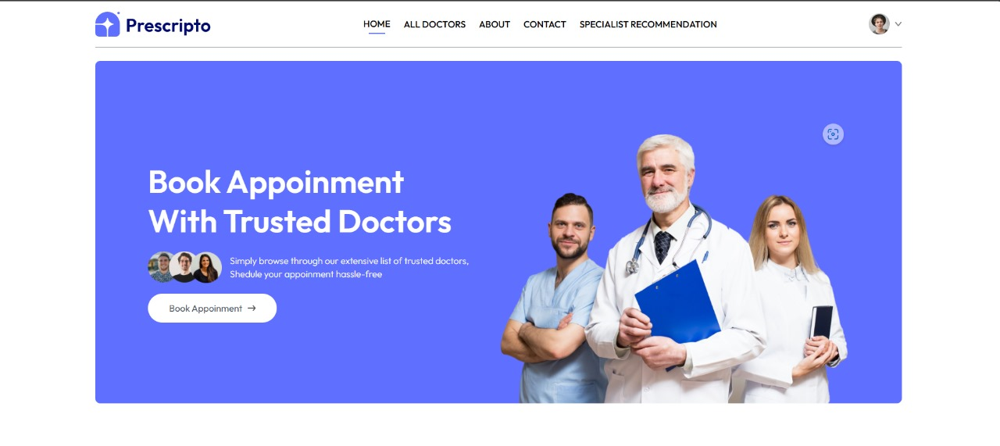 | 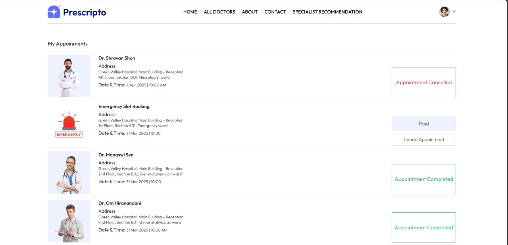 |

| Dynamic Slot Booking | Patient Dashboard & Payments |
|:---:|:---:|
| 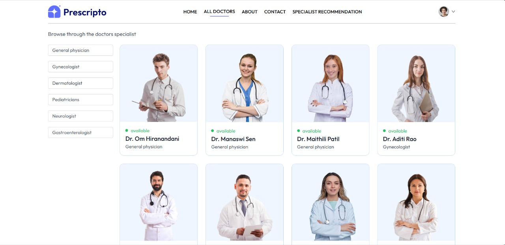 | 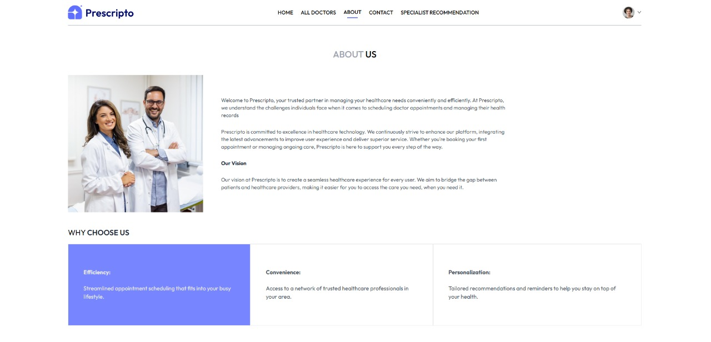 |

| Admin Executive Dashboard | Doctor Management & Onboarding |
|:---:|:---:|
| 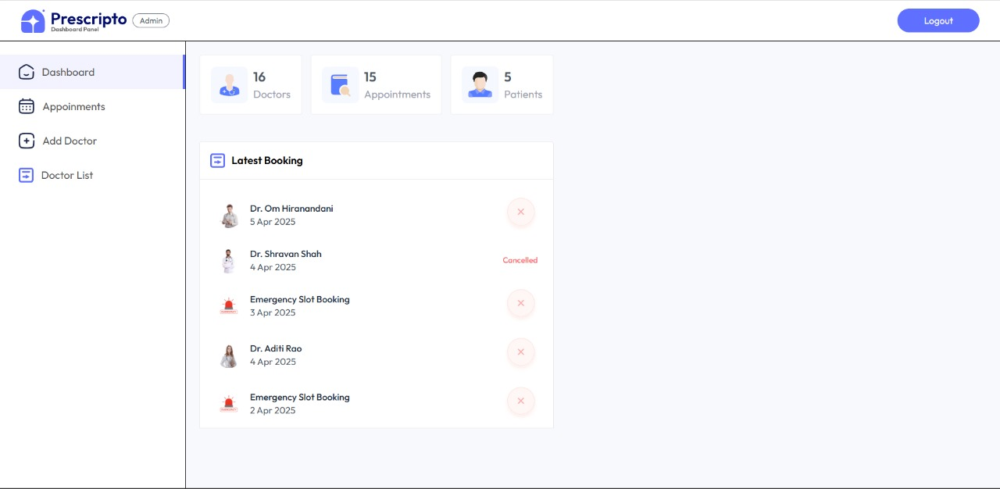 | 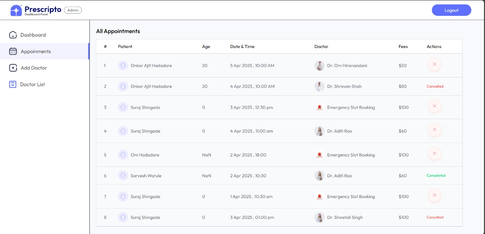 |

| Doctor Appointments Console | Doctor Performance & Profile |
|:---:|:---:|
| 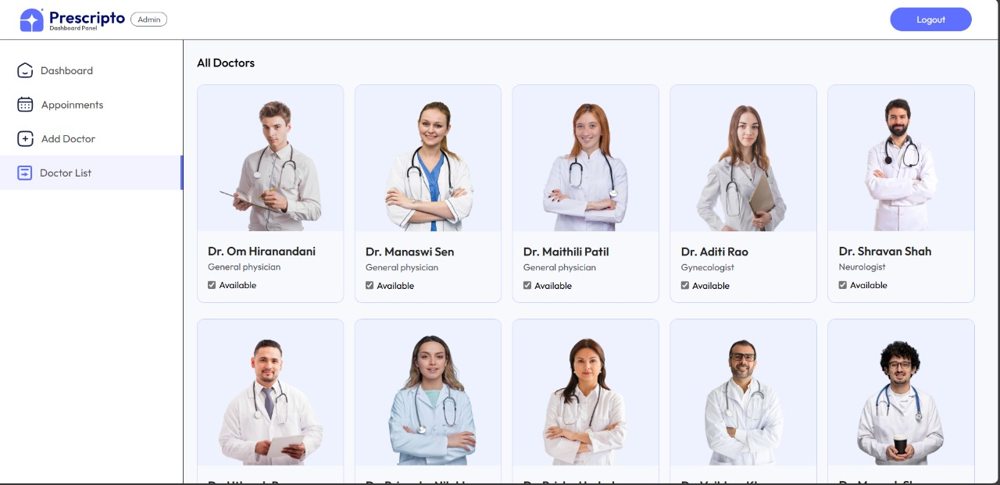 | 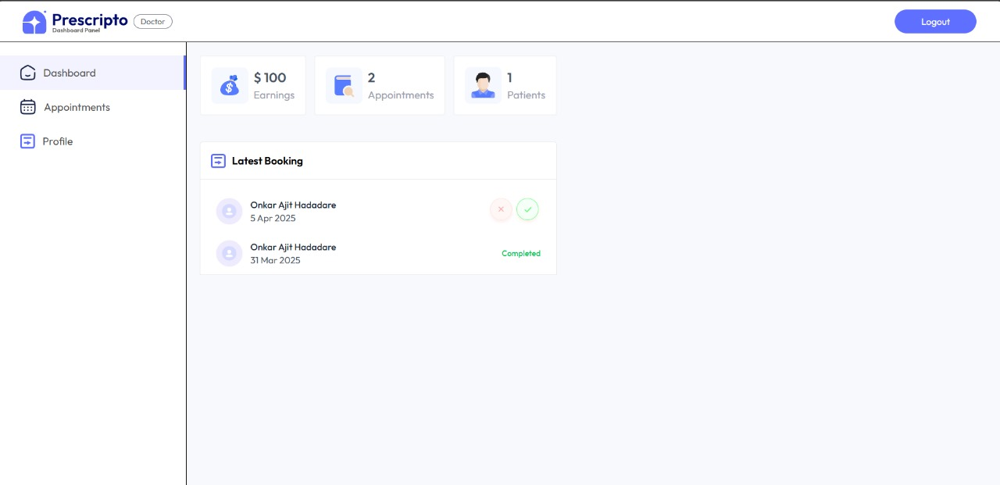 |

<details>
<summary><b>🔍 View More Screenshots (Click to Expand)</b></summary>
<br>

| Specialty Filter | Mobile Responsive View | Booking Summary |
|:---:|:---:|:---:|
| 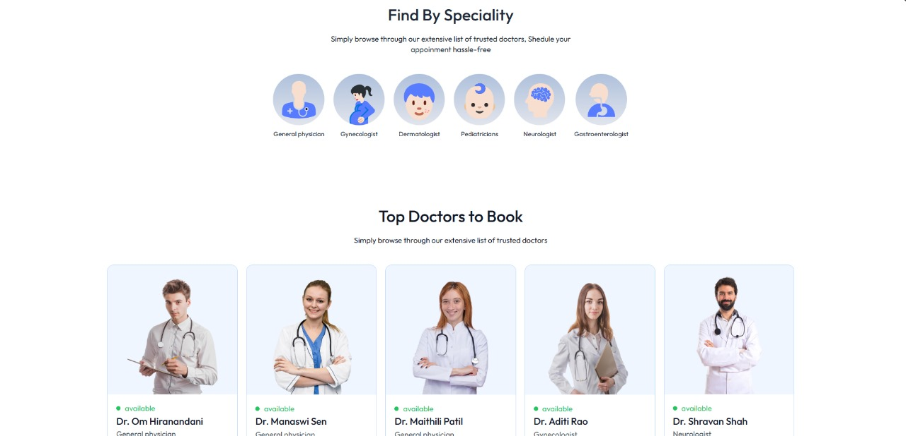 |  | 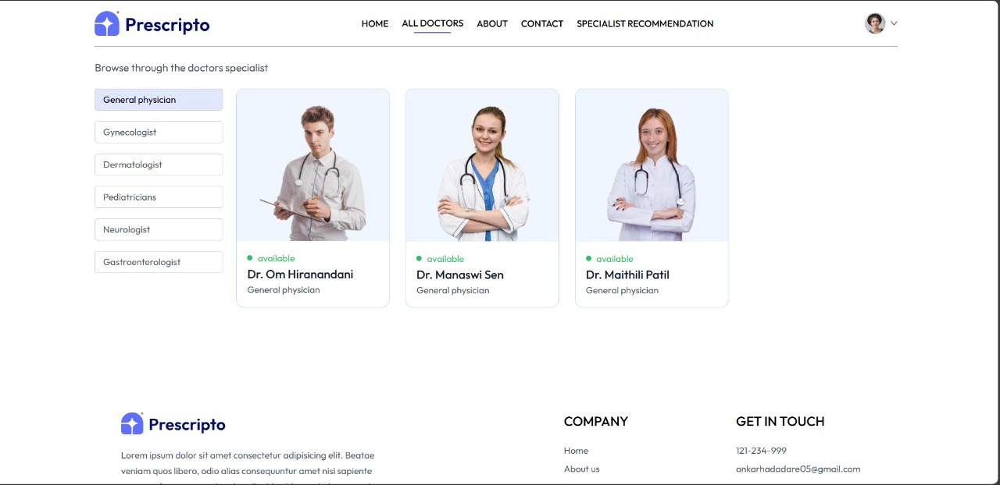 |

| User Profile View | Authentication Modal | Admin Doctor Directory |
|:---:|:---:|:---:|
| 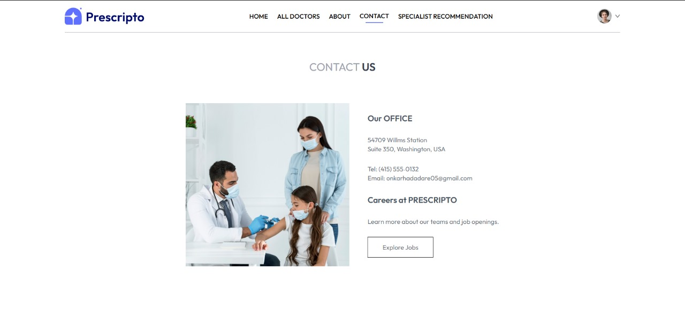 | 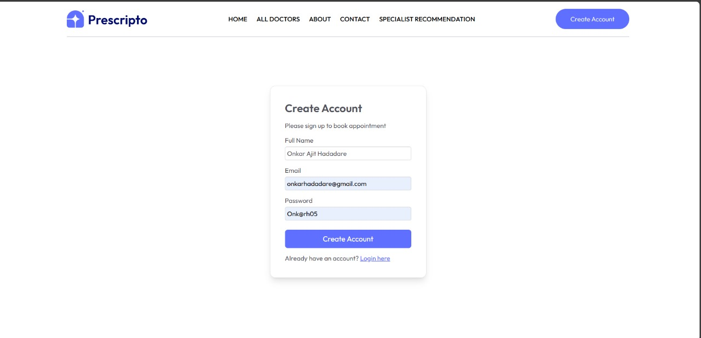 | 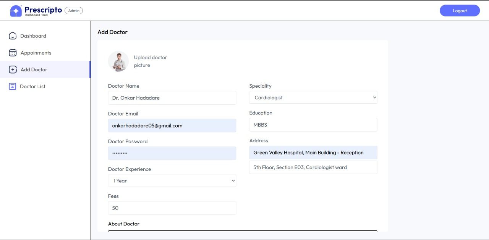 |

</details>

---

## 🔌 API Reference Guide

### 🔐 Authentication & Admin Endpoints (`/api/admin`)
| Method | Endpoint | Description | Access |
| :--- | :--- | :--- | :--- |
| `POST` | `/api/admin/login` | Authenticate platform administrator | Public |
| `POST` | `/api/admin/add-doctor` | Onboard new physician (Multer image upload) | Admin (JWT) |
| `POST` | `/api/admin/all-doctors` | Retrieve complete roster of registered doctors | Admin (JWT) |
| `POST` | `/api/admin/change-availablity` | Toggle global doctor availability | Admin (JWT) |
| `GET` | `/api/admin/appointments` | Fetch universal appointment history | Admin (JWT) |
| `POST` | `/api/admin/cancle-appointment` | Administratively cancel an appointment | Admin (JWT) |
| `GET` | `/api/admin/dashboard` | Fetch aggregated hospital metrics & telemetry | Admin (JWT) |

### 🩺 Physician Endpoints (`/api/doctor`)
| Method | Endpoint | Description | Access |
| :--- | :--- | :--- | :--- |
| `GET` | `/api/doctor/list` | Get list of all available doctors | Public |
| `POST` | `/api/doctor/login` | Doctor login with email & password | Public |
| `GET` | `/api/doctor/appointments` | Get appointments assigned to logged-in doctor | Doctor (JWT) |
| `POST` | `/api/doctor/complete-appointment` | Mark consultation as completed | Doctor (JWT) |
| `POST` | `/api/doctor/cancle-appointment` | Cancel a scheduled consultation | Doctor (JWT) |
| `GET` | `/api/doctor/dashboard` | Get earnings, patient count, and schedule | Doctor (JWT) |
| `GET` | `/api/doctor/profile` | Get doctor's profile details | Doctor (JWT) |
| `POST` | `/api/doctor/update-profile` | Update fees, clinic address, or availability | Doctor (JWT) |

### 👤 Patient Endpoints (`/api/user`)
| Method | Endpoint | Description | Access |
| :--- | :--- | :--- | :--- |
| `POST` | `/api/user/register` | Register a new patient account | Public |
| `POST` | `/api/user/login` | Patient login | Public |
| `GET` | `/api/user/get-profile` | Get user profile data | User (JWT) |
| `POST` | `/api/user/update-profile` | Update profile information and avatar | User (JWT) |
| `POST` | `/api/user/book-appointment` | Reserve a doctor consultation slot | User (JWT) |
| `GET` | `/api/user/appointments` | Get patient's appointment history | User (JWT) |
| `POST` | `/api/user/cancle-appointment` | Cancel user's booked appointment | User (JWT) |
| `POST` | `/api/user/appointment-payment` | Generate Razorpay transaction order | User (JWT) |
| `POST` | `/api/user/verify-payment` | Verify Razorpay HMAC-SHA256 signature | User (JWT) |

### 🧠 AI / ML Microservice Endpoint (`:5000`)
| Method | Endpoint | Payload Sample | Response Output |
| :--- | :--- | :--- | :--- |
| `POST` | `/predict` | `{"symptoms": ["chills", "fatigue", "high_fever"]}` | Top-3 diagnosis probabilities, confidence %, and specialist recommendation |

---

## ⚙️ Local Installation & Development Setup

### 📋 Prerequisites
* **Node.js** v18+ / v20+ (`node -v`)
* **Python** 3.10+ (`python --version`)
* **Git** (`git --version`)
* **MongoDB Atlas** database connection URI
* **Cloudinary** account credentials
* **Razorpay** test API keys

---

### Step 1: Clone the Repository
```bash
git clone https://github.com/your-username/Prescripto-AI-Powered-Dynamic-Appointment-Scheduler.git
cd Prescripto-AI-Powered-Dynamic-Appointment-Scheduler
```

---

### Step 2: Configure Environment Variables

#### 1. Backend (`backend/.env`)
```env
PORT=4001
MONGODB_URL='your_mongodb_atlas_connection_string'
CLOUDINARY_NAME='your_cloudinary_cloud_name'
CLOUDINARY_API_KEY='your_cloudinary_api_key'
CLOUDINARY_API_SECRET='your_cloudinary_api_secret'
ADMIN_EMAIL="admin@prescripto.com"
ADMIN_PASSWORD="YourSecureAdminPassword"
JWT_SECRET='your_super_secret_jwt_key'
RAZORPAY_KEY_ID='rzp_test_your_key_id'
RAZORPAY_KEY_SECRET='your_razorpay_secret'
CURRENCY="INR"
```

#### 2. Frontend (`frontend/.env`)
```env
VITE_BACKEND_URL='/myapi'
VITE_RAZORPAY_KEY_ID='rzp_test_your_key_id'
VITE_ML_URL='http://localhost:5000'
```

#### 3. Admin (`admin/.env`)
```env
VITE_BACKEND_URL='/myapi'
```

---

### Step 3: Start Services (Multi-Terminal Setup)

Open 4 separate terminal windows in your root directory:

#### 🖥️ Terminal 1 — Backend REST API
```bash
cd backend
npm install
npm run server
# Running on http://localhost:4001
```

#### 🖥️ Terminal 2 — Machine Learning Microservice
```bash
cd "ML Modelss"
pip install flask flask-cors pandas scikit-learn numpy
python app.py
# Running on http://localhost:5000
```

#### 🖥️ Terminal 3 — Patient Frontend Portal
```bash
cd frontend
npm install
npm run dev
# Running on http://localhost:5173
```

#### 🖥️ Terminal 4 — Admin & Doctor Portal
```bash
cd admin
npm install
npm run dev
# Running on http://localhost:5174/admin/
```

---

## 🐳 Docker Deployment Setup

The repository includes a production-grade multi-stage `dockerfile` and `docker-compose.yml` configured with an Nginx reverse proxy.

```bash
# Build and spin up all containerized services
docker-compose up --build -d

# View live streaming container logs
docker-compose logs -f
```

* **Patient Web App:** `http://localhost/`
* **Admin & Doctor Console:** `http://localhost/admin/`
* **Backend API Gateway:** `http://localhost/myapi/`

---

## 🛡️ Security & Reliability Implementations

* **Cryptographic Passwords:** All passwords hashed via `bcrypt` with work factor 10.
* **Token-Based Sessions:** Stateless JWT authentication tokens with validation middleware preventing unauthorized access to protected routes.
* **Anti-Tampering Payments:** Financial transactions verified through HMAC SHA-256 signature calculations comparing `razorpay_order_id`, `razorpay_payment_id`, and secret keys.
* **CORS Whitelisting:** Fine-grained Cross-Origin Resource Sharing rules preventing cross-site scripting vulnerabilities.
* **Robust File Sanitization:** Multi-part file uploads bounded to image MIME types before streaming to cloud storage.

---

## 🔮 Future Roadmap & Scalability Enhancements

- [ ] **WebRTC Telemedicine Integration:** In-browser encrypted 1-on-1 video consultations between doctor and patient.
- [ ] **Redis Distributed Slot Locking:** Sub-millisecond distributed lock management during peak holiday appointment surges.
- [ ] **Automated WhatsApp & Email Notifications:** Real-time booking confirmations, reminders, and prescription PDFs via Twilio/SendGrid.
- [ ] **Expanded Deep Learning Triage:** Multi-modal analysis accepting dermatology photo uploads via Convolutional Neural Networks (CNNs).

---

## 📄 License & Attribution

This project is licensed under the **ISC License**. Developed as an advanced full-stack & AI healthcare solution.

---

<p align="center">
  <b>Built with ❤️ for modern, accessible healthcare delivery.</b>
</p>
